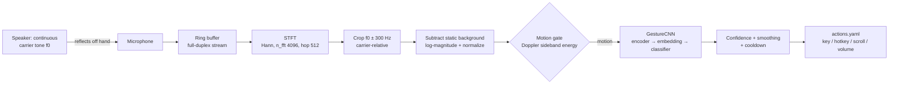

# EchoTouch

[](https://github.com/ega-nithin-sai/EchoTouch/actions/workflows/ci.yml)

[](LICENSE)

**Touchless gesture control for your laptop, using only its built-in speaker and microphone.**

EchoTouch plays a near-inaudible tone (17–21 kHz) through the speaker and listens to its echo
with the microphone. A moving hand Doppler-shifts that echo. A small CNN, trained **only on clips you
record yourself**, turns those shifts into gestures (push, pull, wave and more) that can trigger
keyboard shortcuts. No camera and no extra hardware.

> **Status:** experimental. The pipeline is tested end to end with a physics-based simulator and
> mocked audio devices. How well it works on *your* laptop depends on your speaker, mic and room.
> See [Limitations](#honest-limitations).

<!-- docs/images/dashboard.png: add a screenshot of the Live Control Center here -->

---

## How it works



A hand moving toward the laptop at radial speed *v* shifts the echo by Δf ≈ 2·v·f₀ / c. At
f₀ = 18.5 kHz that's about ±50–200 Hz for normal hand speeds, which is why the spectrogram is
cropped to ±300 Hz around the carrier. Pushes show up as energy **above** the carrier and pulls
**below** it. Static reflections and direct speaker→mic leakage are removed by subtracting each
frequency's median over time.

```
 time ──────────────────────────►
 +300 Hz │            ▓▓            ← push: hand approaches → positive shift
         │          ▓▓▓▓
   f0 ───┼──────────────────────────  (static carrier, removed)
         │                  ▓▓▓▓
 -300 Hz │                    ▓▓    ← pull: hand recedes → negative shift
```

## Why you must record your own data

There is **no public dataset** for this, and a generic one wouldn't transfer well. The signal
depends on:

- where your laptop's speakers and microphones sit, and how they're filtered,
- your mic's sensitivity and your OS's audio processing,
- your room, your desk and your hand.

So `profiles/` starts empty, and the model is trained **only on real audio you record**. The
enrollment wizard walks you through it in rounds, varying speed, distance and hand position, and
records "idle" behaviour (typing, head movement, people walking past) so the model learns what
to ignore.

## Install

Requires Python 3.10+ and a laptop with a built-in speaker and microphone. Windows is the primary
target; macOS and Linux should work but are less tested.

```bash
git clone https://github.com/ega-nithin-sai/EchoTouch.git
```

```bash
cd EchoTouch
```

```bash
python -m venv .venv
```

Activate the venv (Windows: `.venv\Scripts\activate`, macOS/Linux: `source .venv/bin/activate`), then:

```bash
pip install torch --index-url https://download.pytorch.org/whl/cpu
```

```bash
pip install -r requirements.txt
```

A GPU isn't needed; the CPU build of torch is enough. On Linux you may also need `sudo apt install libportaudio2`.

## Quickstart

### 1. Check your hardware: `python doctor.py`

```bash
python doctor.py
```

The doctor plays the tone, checks that the mic hears it, sweeps 17–21 kHz to find the best carrier
(preferring higher, less audible frequencies), and checks clipping and stability (dropouts usually
mean OS "audio enhancements" or Bluetooth). It prints PASS/WARN/FAIL with fixes and saves the
calibration to `profiles/default/`.

> ⚠️ Some people and pets can hear 17–19 kHz. Keep the volume low (default 0.3).
> Changing the carrier or volume later invalidates recorded data and models.

### 2. Record your gestures: `python enroll.py`

```bash
python enroll.py --rounds 2
```

- You record in **rounds** of 25 clips per gesture. Each round asks for a different variation:
  fast/close, slow/far, left/right side, other hand, and so on.
- Each clip goes "Get ready: PUSH … 3, 2, 1, GO!", then records 1.5 s and checks quality right
  away (no motion detected → re-record; clipping → re-record; low SNR → warning).
- Keys during review: `Enter` next · `u` undo · `r` redo · `n` next idle type · `s` skip · `q` quit.
- Progress is saved after every clip, so re-running resumes.

**Recommended amounts:** start with **50 clips per gesture** to check that it works at all on your
machine. Then build up to **150–200 per gesture** over **several sessions** (different times of
day and postures). Multiple sessions also make validation honest (see below).

### 3. Train: `python train.py`

```bash
python train.py
```

- The validation split is **by session/round, never random**. Back-to-back clips are nearly
  identical, so random splits report a fake 99%. With only one session, later rounds are held out
  and you'll get a warning that the numbers are optimistic.
- Uses class-balanced sampling, AdamW, cosine LR, early stopping and best-checkpoint saving.
- Writes `model.pth`, `report.json` and `confusion_matrix.png` into the profile, and **flags weak
  classes**.
- Also learns a motion-gate threshold from your idle and gesture clips.

### 4. Go live: `python inference.py`

```bash
python inference.py
```

This only recognizes and prints gestures; **OS control is OFF by default**. To enable it:

```bash
python inference.py --enable-control --dry-run
```

```bash
python inference.py --enable-control
```

Gesture→action mappings live in [`actions.yaml`](actions.yaml) (key, hotkey, scroll, volume or a
custom command). pyautogui's FAILSAFE stays on: throw the mouse into a screen corner to abort.

### 5. Dashboard: `streamlit run app.py`

```bash
streamlit run app.py
```

- **Enrollment Studio:** guided recording with countdown, quality feedback, undo, per-gesture
  counts, and waveform/spectrogram previews.
- **Model Training:** background training with live loss/accuracy curves, confusion matrix and
  per-class precision/recall.
- **Live Control Center:** a real-time Doppler spectrogram that lights up when your hand moves,
  live class probabilities, motion-gate status, a log of recent gestures, and an OS-control
  toggle (off by default).

### Try it without hardware: `--simulate`

Every tool accepts `--simulate`, which swaps the microphone for a physics-based acoustic simulator
(bistatic speaker/mic geometry, exact time-varying path delay, leakage, noise, keyboard clicks,
passers-by).

```bash
python doctor.py --simulate --profile demo
```

```bash
python enroll.py --simulate --profile demo --fast --rounds 2 --clips 15
```

```bash
python train.py --simulate --allow-simulated --profile demo
```

```bash
python inference.py --simulate --profile demo --demo --enable-control
```

In the dashboard, flip **Simulate mode** in the sidebar. The *Model Training* page can generate a
demo dataset, and the *Live Control Center* has "perform push/pull/wave" buttons.

> **SIMULATED MODE: not real data.** Simulated clips and models live only in `sim/`, are tagged
> `source: "simulated"`, and are **refused for real control**. Training on them requires
> `--allow-simulated`, and real and simulated clips are never mixed. The simulator exists for
> tests, CI, demos, and letting visitors explore the dashboard. Its accuracy says nothing about
> real hardware.

## Gestures

Configured in [`gestures.yaml`](gestures.yaml):

| Tier | Gestures | Notes |
|---|---|---|
| **Core** | `idle`, `push`, `pull`, `wave` | Radial motion, which is what Doppler measures best. Enabled by default. |
| **Advanced (experimental)** | `swipe_left`, `swipe_right`, `swipe_up`, `swipe_down` | Disabled by default. See limitations. |
| **Custom** | anything you add | Add an entry, record it, retrain. |

`idle` is the required reject class. Enrollment prompts for its sub-types: silence, typing, head
movement, someone walking by, and ambient.

## Honest limitations

- **Direction gestures are experimental.** Doppler only measures *radial* velocity (toward or
  away from the speaker+mic). A left swipe and a right swipe both approach and then recede.
  They differ only through subtle geometry and asymmetry (where the speaker and mic sit), so
  expect them to be confused with each other. `train.py` flags weak classes. Push, pull and wave
  are the realistic targets.
- **OS audio processing can break it.** Noise suppression, "audio enhancements", Voice Clarity,
  communications-mode ducking and AGC may remove or modulate the carrier. `doctor.py` detects
  this; see [TROUBLESHOOTING](docs/TROUBLESHOOTING.md).
- **Bluetooth doesn't work.** Its mic profile is band-limited far below 17 kHz.
- **Audibility.** Some people and most pets can hear 17–19 kHz. Use the lowest volume that works
  and the highest carrier the doctor recommends.
- **Battery/CPU.** Full-duplex audio plus an STFT every 100 ms costs a few percent CPU, and the
  CNN only runs when the motion gate opens. Expect some extra battery drain while it runs.
- **Your setup is the model.** If you move the laptop to a very different room, change the
  carrier or volume, or switch devices, accuracy may drop. Record another session or start a new profile.
- **Not verified on real hardware by the author's CI.** CI runs on runners without audio devices,
  so all audio I/O there is mocked or simulated.

## Results

> Fill this in with your own numbers after `python train.py`. They are specific to your laptop
> and your recordings.

| Profile | Laptop | Sessions | Clips/gesture | Split | Accuracy | Balanced acc. |
|---|---|---|---|---|---|---|
| _yours_ | _model_ | _n_ | _n_ | session | _–_ | _–_ |

<!--  -->
_Confusion matrix placeholder: copy `profiles/<name>/confusion_matrix.png` to `docs/images/`._

## Project layout

| File | Purpose |
|---|---|
| `config.py` | All settings as frozen dataclasses; gesture loading |
| `audio_stream.py` | Thread-safe full-duplex `AudioEngine`: phase-continuous tone, ring buffer, device selection |
| `dsp.py` | STFT, carrier crop, background subtraction, normalization, motion/SNR/quality metrics, augmentation |
| `simulator.py` | Physics-based Doppler simulator and `SimulatedAudioEngine` (tests and demos only) |
| `profiles.py` | Profile storage: raw float32 WAV clips plus `manifest.json`, with the simulated/real guardrails |
| `dataset.py` | Leakage-free session/round splitting, torch dataset |
| `model.py` | `GestureCNN` (encoder → embedding → classifier, `.embed()`), checkpoints with DSP metadata |
| `train.py` | Training CLI and library (reports, confusion matrix, weak-class flags) |
| `inference.py` | Motion gate, smoothing, cooldown, background inference worker, CLI |
| `actions.py` / `actions.yaml` | Gesture → OS action mapping, dry-run, FAILSAFE |
| `doctor.py` | Hardware check and carrier calibration |
| `enroll.py` | Enrollment logic (shared with the dashboard) and terminal wizard |
| `engine.py` | Thin orchestration for the CLIs and the dashboard |
| `app.py` | Streamlit dashboard |

Raw audio is stored (not spectrograms), so you can change STFT parameters later without
re-recording. Every DSP parameter is saved in the manifest and in each checkpoint, and inference
refuses to run on a mismatch.

## Development

```bash
pip install -r requirements-dev.txt
```

```bash
ruff check .
```

```bash
pytest -q
```

The test suite needs no audio hardware: `sounddevice` and `pyautogui` are mocked. It includes an
end-to-end CPU test (simulate → train → live inference on a simulated stream) that runs in well
under two minutes.

## Roadmap (future work, not implemented)

- **Few-shot onboarding:** prototype-based enrollment using `GestureCNN.embed()` so new users
  need far fewer clips.
- **Pretrained base model:** a shipped encoder in `models/pretrained/` (already excluded from the
  `*.pth` ignore rule), fine-tuned per user.
- **ONNX export** for a lighter runtime.

## License

[MIT](LICENSE)
